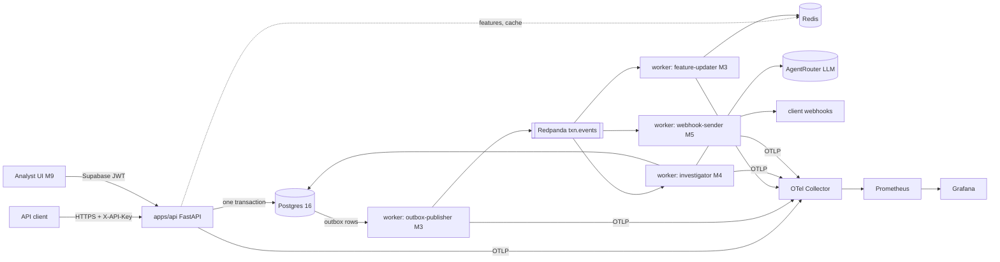

# Architecture

> **Implemented (M0):** repository layout, configuration, logging, correlation IDs, OTel export, DB engine, Alembic baseline, `/healthz`, `/readyz`, local infrastructure.
> Everything marked **Planned (Mx)** is the agreed design from Final Plan v2, not yet code.

## Style
A modular monolith plus worker roles (ADR-001). One core package, one API process, and one worker entrypoint with roles.

## Module boundaries (`packages/ledgerguard/src/ledgerguard/`)
| Module | Responsibility | May import | Status |
|---|---|---|---|
| `domain/` | Pure dataclasses/enums, state machines, Money, errors | stdlib only | Planned (M1) |
| `risk/` | Rules (YAML, versioned), features, model registry, policy | domain | Planned (M2) |
| `application/` | Use cases; depend on repository **protocols** | domain, risk, events | Planned (M1) |
| `infrastructure/` | SQLAlchemy models/repositories/UoW, Redis, Kafka, LLM, auth | everything above | **M0: db engine, base, migrations, health probes** |
| `events/` | Versioned event schemas, outbox writer, inbox dedup, consumer base | domain | Planned (M3) |
| `investigation/` | Evidence gatherer, prompts, output schema, validator | domain, application | Planned (M4) |
| `rag/` | Chunkers, embedder, retriever, reranker, evals | — | Planned (M7–8) |
| `observability/` | structlog, correlation IDs, OTel | — | **M0: implemented** |
| `config.py` | Typed settings (`LG_*` env vars) | — | **M0: implemented** |

Rules: `domain` never imports infrastructure. Routers call use cases only. Dependencies are wired in the app lifespan / `apps/api/deps.py` (no DI framework).

## Composition root (M0)
`apps/api/main.py:create_app()` configures logging and builds resources in the lifespan: the async engine, Redis client and readiness probes. Resources are stored on `app.state`, and `deps.py` hands them to routes. Tests inject fakes through `create_app(settings, probes=...)` instead of monkeypatching.

## Health and readiness (M0, ADR-011)
| Endpoint | Meaning | Checks | Failure |
|---|---|---|---|
| `/healthz` | Process alive | none | — (always 200 while the loop runs) |
| `/readyz` | Can serve traffic correctly | Postgres reachable **and** `alembic_version` = code head (required); Redis, Redpanda (optional) | 503 if a required check fails; 200 `degraded` if only optional ones fail |

## Hot path — Planned (M1–M2), target p99 < 100 ms
`auth → canonical hash → UoW.begin → INSERT idempotency (PG unique PK resolves races) → features (Redis, PG fallback) → rules + model → policy → INSERT transaction, risk_decision, audit_event, outbox_event → UPDATE idempotency response → commit → 201`. No LLM and no vector search on this path.

## Cold path — Planned (M3–M5)
`outbox-publisher (FOR UPDATE SKIP LOCKED, batch 100) → txn.events (key = transaction_id) → consumers`. Each consumer inserts into `consumer_inbox` and applies side effects in one Postgres transaction, then commits the offset. Transient errors go to `txn.events.retry` (exponential backoff + jitter, max 5), then `txn.events.dlq`, with a replay CLI.

## Local infrastructure (M0, `docker-compose.yml`)
| Service | Image | Host port | Purpose |
|---|---|---|---|
| postgres | pgvector/pgvector:0.8.0-pg16 | 55432 | System of record (5432 is often taken on dev hosts) |
| redis | redis:7.4-alpine | 6379 | Feature windows, response cache, budgets (degradable) |
| redpanda | redpanda:v24.2.7 | 19092 | Kafka-API broker for domain events |
| redpanda-console | console:v2.8.0 | 8080 | Inspect topics, consumer groups, DLQ |
| otel-collector | opentelemetry-collector-contrib:0.111.0 | 4317/4318 | Receives OTLP; exports metrics for Prometheus |
| prometheus | prom/prometheus:v2.54.1 | 9090 | Metrics storage (collector, Redpanda) |
| grafana | grafana/grafana:11.2.2 | 3000 | Dashboards (datasource provisioned; dashboards M6) |

All ports bind to 127.0.0.1. Every service has a healthcheck except the distroless collector, whose health is shown by Prometheus target status. Production compose (`compose.prod.yml`) is M10.

## Deployment — Planned (M10)
One EC2 host with `compose.prod.yml` and Caddy TLS, Supabase Postgres and Auth, secrets from SSM, and images built by GitHub Actions. The ECS/Fargate path is documented only.
